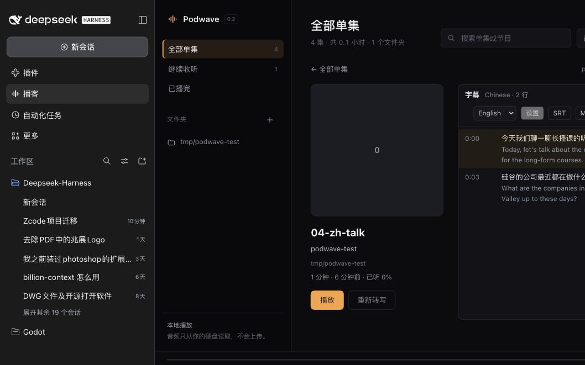

# dsh-podwave

DeepSeek Harness 的本地播客播放器插件：在 DSH 侧栏里播放硬盘上的播客，自动记住进度，并且能转写、显示双语字幕、导出 SRT / Markdown。

音频只从本地磁盘读取，不上传、不联网、不依赖订阅源。转写与翻译默认跑在本机（Apple Silicon / MLX），也可以切到 DeepSeek API。



## 功能

- **单集详情**：点任意一集进入详情页——左侧封面与信息，右侧直接显示字幕，转写后可切中英对照。
- **本地播放**：扫描文件夹（递归 6 层，支持 `mp3 / m4a / m4b / aac / wav / flac / ogg / opus / weba / webm / wma`），自动读标题、艺术家、封面。
- **续播**：进度每 4 秒保存，切集 / 暂停 / 关闭时立即保存；重开从上次位置继续。
- **转写**：本地 Qwen3-ASR-1.7B-8bit，带词级时间戳；按停顿与标点切成字幕行。
- **任务面板与批量**：顶部「任务」查看队列、进度，可取消 / 重试；「选择」多选批量转写。
- **长播客分块**：按 15 分钟切块转写，取消或失败后从已完成块续跑；热词可在设置里维护。
- **说话人分离**：转写后自动分辨说话人（本地声纹，离线），字幕行带彩色「说话人 N」标签；字幕头部显示人数。
- **收藏与筛选**：每行 ★ 收藏；筛选条可按 未听 / 有字幕 / 收藏 过滤，和左侧分类叠加。
- **双语字幕**：点「字幕」打开面板，选「中文对照 / English」，只翻译另一种语言的行；点字幕行可以跳到对应时间。
- **字幕编辑**：行悬停出现 ✎，就地改文本；按光标「拆分」、行尾 ⇣ 合并；右上「撤销」最多回退 20 步；「校验」在导出前检查空行、无效时间戳与时间重叠。
- **移除索引**：详情页「从播放器移除」或批量「移除选中」只隐藏该集，不动源文件。
- **导入策略**：设置里可选拖拽/路径导入是复制到 `~/.podwave/imports/`（默认）还是原地引用；重复文件按路径与「文件名 + 大小」跳过。
- **导出**：SRT 或 Markdown。
- **快捷键**：`空格` 播放/暂停，`← / →` ±15 秒，`↑ / ↓` 上/下一集，`/` 搜索。
- **收起侧栏**：点侧栏顶部标题右边的 `‹` 收起，左上角 `›` 展开；状态记在 `~/.podwave/ui.json`。面板被 DSH 挤窄时会自动收起侧栏，详情页改为上下布局。
- **设置页**：DSH 设置 → 播客，可以看已完成的转写历史、配置 DeepSeek API、选择转写与翻译模型、控制侧边栏入口是否显示。

## 实时字幕

转写不用等整集结束。音频按块处理（默认 1 分钟一块），每完成一块就把新字幕推进面板：

- 字幕面板顶部显示进度：百分比、第几块、已出多少行，可随时取消；
- 转写中就能在详情页滚动、点行跳转、导出当前已出的 SRT/Markdown；
- 重转时旧字幕会备份，取消或失败自动还原。

分块时长可在设置 → 播客 → 转写里调整；块越小出字越快，块越大上下文越完整。

## 安装

需要 DeepSeek Harness `>=0.2.1-rc.5`。

从 [Releases](https://github.com/Watchcats211/dsh-podwave/releases) 下载最新的 `dsh-podwave-*.tgz`，然后：

```bash
dsh plugin --profile desktop add file:/path/to/dsh-podwave-0.6.0.tgz
```

也可以直接从源码目录装：

```bash
dsh plugin --profile desktop add file:/path/to/dsh-podwave
```

装完刷新 DSH，侧栏出现「播客」。

## 转写与翻译（可选）

播放器本身不需要额外依赖。要用转写 / 翻译，需要在本机准备 MLX 运行时：

```bash
uv venv ~/.podwave/runtime/.venv --python 3.12
uv pip install --python ~/.podwave/runtime/.venv/bin/python "mlx-qwen3-asr==0.4.4" mlx-lm sherpa-onnx

hf download mlx-community/Qwen3-ASR-1.7B-8bit --local-dir ~/.podwave/models/qwen3-asr-1.7b-8bit
hf download mlx-community/Hy-MT2-1.8B-4bit --local-dir ~/.podwave/models/hy-mt2-1.8b-4bit

# 说话人分离模型（约 34MB）
mkdir -p ~/.podwave/models/diarization && cd ~/.podwave/models/diarization
curl -LO https://github.com/k2-fsa/sherpa-onnx/releases/download/speaker-segmentation-models/sherpa-onnx-pyannote-segmentation-3-0.tar.bz2
tar xjf sherpa-onnx-pyannote-segmentation-3-0.tar.bz2
curl -LO https://github.com/k2-fsa/sherpa-onnx/releases/download/speaker-recongition-models/3dspeaker_speech_campplus_sv_zh_en_16k-common_advanced.onnx
```

- 转写模型约 2.3 GB，翻译模型约 1 GB（Hy-MT2-1.8B，974 MB），说话人模型约 34 MB；只做播放可以都不装。
- 翻译可以不用本地模型：字幕面板 →「设置」→ 选 DeepSeek API，填 API key（默认 `api.deepseek.com` / `deepseek-chat`）。
- 字幕面板 →「设置」里切换引擎；目标语言在字幕面板的「对照」下拉里选。

## 设置

DSH 设置 →「播客」：

- **历史记录**：所有已完成转写的单集（时长、语言、行数、位说话人、已翻语言、完成时间）。
- **转写**：热词、分块时长（1–60 分钟）、是否自动识别说话人。
- **API 与翻译引擎**：DeepSeek API 地址 / 模型 / API Key，或切到本地模型。
- **模型**：在 `~/.podwave/models/` 下已就绪的模型里选转写模型（ASR）与翻译模型。
- **界面**：开关「在主界面侧边栏显示播客入口」，保存后立即生效（不需要刷新）。
- **导入与清理**：选择复制/原地引用；清理没有被文件夹引用的 `imports/` 批次。

## 用法

- **添加文件夹**：点面板左上 `+` → 「选择文件夹…」调用系统目录选择器；也可以直接把音频文件拖进面板（会复制到 `~/.podwave/imports/`）。手动输入路径保留为备选。扫描在后台进行，状态显示在底部。
- **播放 / 续播**：点单集；刷新或重开 DSH 后接着上次位置。
- **转写**：点播放条右侧「转写」，完成后自动打开字幕面板。长播客需要时间（M4 上大约 5–10 倍实时速度）。
- **翻译**：字幕面板右上「对照」选目标语言；已有译文会直接显示，没有就自动开始翻。
- **删除文件夹**：侧栏文件夹右侧 `×`，会移除该目录下的单集记录。

数据保存在 `~/.podwave/`：`state.json`（媒体库/进度/收藏/隐藏）、`config.json`（统一配置）、`jobs.json`（任务记录）、`transcripts/`（字幕 v2）、`covers/`、`models/`、`runtime/`、`imports/`（拖拽导入的音频副本）。数据与配置的详细结构见 [docs/ARCHITECTURE.md](docs/ARCHITECTURE.md)。

## 结构

```
src/host.js                /podwave/api/*：播放器、转写、翻译、字幕导出
src/state.js               状态读写（~/.podwave/state.json，原子写）
src/library.js             媒体库扫描（music-metadata）
src/transcribe.js          MLX Qwen3-ASR 调用、队列、字幕分行与导出
src/translate.js           翻译任务（DeepSeek API / 本地 MLX Qwen3）
src/diarize.js             说话人分离（sherpa-onnx，本地声纹）
src/models.js              模型目录扫描与选择（config.models）
src/config.js              统一配置（~/.podwave/config.json，迁移旧 ui/translate/models.json）
src/jobs.js                任务记录（~/.podwave/jobs.json，重启标 interrupted）
scripts/translate_local.py 本地翻译脚本（mlx_lm）
scripts/diarize.py         说话人分离脚本（sherpa-onnx）
client/src/                React 面板（App.jsx、SettingsPage.jsx、plugin.jsx、styles.css）
build.mjs                  PostCSS 作用域前缀 + esbuild 打包为 DSH client bundle
cordis.patch.yml           插件加载声明
docs/ARCHITECTURE.md       架构、数据格式、API 表
CHANGELOG.md               版本记录
```

版本变化见 [CHANGELOG.md](CHANGELOG.md)。

## 开发

```bash
npm install
npm run build          # 产物 dist/client.js

# 独立测试 profile（不影响 desktop）
dsh podwave-test --from-default-profile web --no-open --port 4790
dsh plugin --profile podwave-test add file:$PWD
```

## 限制

- 还没有 RSS / 在线流订阅，只播放本地文件。
- 说话人分离是转写后整段批处理，不是实时；暂不支持手动改名或合并说话人。
- 转写是「事后整段」模式，不是真流式；播放中可以先听，转写完成后字幕会出现在面板里。
- 本地翻译是 Hy-MT2-1.8B 4bit（约 1 GB），轻量、快；长句质量仍不如 API，重要内容建议用 DeepSeek API 翻。

## 路线图

- [x] 转写：本地 MLX Qwen3-ASR（中英混合），词级时间戳
- [x] 双语字幕：本地 Hy-MT2-1.8B / DeepSeek API
- [x] 导出 SRT / Markdown
- [x] 系统文件夹选择器与音频拖拽导入
- [ ] 说话人分离与说话人标签
- [ ] 跟播预转写（边播边出字幕）
- [ ] RSS / 在线播客订阅

## License

MIT

## 开发与发布

```bash
npm install
npm test          # node:test 单元测试
npm run build     # 构建 dist/client.js
node scripts/release.mjs 0.9.1   # 改版本号 → 测试 → 构建 → 打包 → commit/tag/push/Release
```

CI（GitHub Actions）在每次 push / PR 跑 `npm test` 与 `npm run build`。

## 环境与模型（跨平台）

设置 → 播客 → 「环境与模型」会扫描本机，给出推荐引擎与缺失组件：

| 平台 | 转写 | 翻译 |
| --- | --- | --- |
| macOS Apple Silicon | Qwen3-ASR-1.7B-8bit（MLX） | Hy-MT2-1.8B-4bit（MLX） |
| Windows / Linux / Intel Mac | SenseVoiceSmall int8（sherpa-onnx） | Hy-MT2-1.8B-Q4_K_M（llama.cpp） |

- 下载线路可选「自动测速 / 国际（Hugging Face、GitHub）/ 国内（hf-mirror、gh-proxy、ModelScope）」。
- 「一键安装」会准备 uv 与 Python 虚拟环境、安装 sherpa-onnx（MLX 平台额外装 mlx-qwen3-asr、mlx-lm）、下载 llama.cpp 预编译包和缺失模型，并在完成后列出每项内容与体积。
- 模型保存在 `~/.podwave/models`，运行时在 `~/.podwave/runtime`；卸载插件不会删除这些文件。
- 注意：Hy-MT2 1.25bit GGUF 是自定义量化，主线 llama.cpp 加载会报 `failed to read tensor data`，所以非 MLX 平台用 Q4_K_M。

### Windows 需要准备什么

- 安装中心会自动下载 ffmpeg（约 202 MB）、llama.cpp（约 25 MB）、SenseVoice（约 239 MB）与 Hy-MT2-Q4_K_M（约 1.1 GB），合计约 1.6 GB，建议预留 3 GB 磁盘。
- Windows 10 及以上自带 `tar` 与 `powershell`，解压和文件夹选择器无需额外安装。
- 安装时会校验下载文件的 sha256（GitHub Release 官方 digest / Hugging Face LFS），并拒绝含 `..` 或绝对路径的压缩包；macOS 没有 ffmpeg 时会尝试通过 Homebrew 安装。
- 首次安装完成后，设置页会列出每项下载内容与体积；模型在 `~/.podwave/models`，运行时在 `~/.podwave/runtime`。

## 小宇宙

侧栏「小宇宙」可以连接小宇宙账号，浏览订阅并在线播放。

小宇宙没有开放 API，插件使用账号的 refresh token 读取数据，token 只保存在本机（`~/.podwave/xyz.json`，权限 600）。

### 获取 refresh token

1. 点插件里的「打开小宇宙网页」，用手机 App 扫码登录 https://www.xiaoyuzhoufm.com 。
2. 按 F12 打开开发者工具 → Network，刷新页面。
3. 点任意一个 `web-api.xiaoyuzhoufm.com` 的请求，在 Request Headers 里复制 `x-jike-refresh-token`。
4. 粘贴到插件里点「连接」。

在线单集可以点「下载并转写」：插件会先把音频下载到 `~/.podwave/xyz-media`，再用本地 ASR 生成字幕，过程在任务面板里可见。

> 注意：这是第三方逆向接口，有极小概率触发账号风控；音频与逐字稿版权归原平台与创作者所有，仅建议个人收听使用。短信验证码登录已被平台限制，界面作为降级选项保留。
