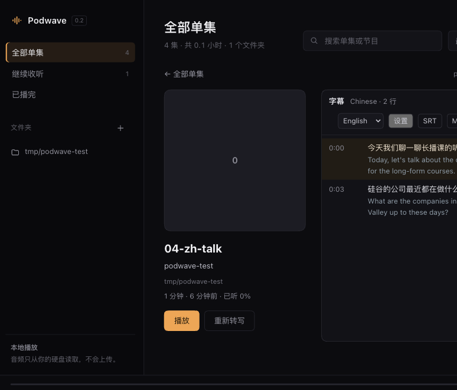

# dsh-podwave

DeepSeek Harness 的本地播客播放器插件：在 DSH 侧栏里播放硬盘上的播客，自动记住进度，并且能转写、显示双语字幕、导出 SRT / Markdown。

音频只从本地磁盘读取，不上传、不依赖订阅源。翻译默认直接用 DSH 里正在用的那个模型（不用另填 key）；转写默认走 DeepSeek API，填一次 key 就行，也可以切到本地模型（MOSS / SenseVoice），离线运行。



## 功能

- **单集详情**：点任意一集进入详情页——左侧封面与信息，右侧直接显示字幕，转写后可切中英对照。点封面就能换一张（图片在浏览器里压到 1200px 再存），「更多」里有「恢复默认封面」。
- **本地播放**：扫描文件夹（递归 6 层，支持 `mp3 / m4a / m4b / aac / wav / flac / ogg / opus / weba / webm / wma`），自动读标题、艺术家、封面。选中一个文件夹后只显示这一层的音频，子文件夹单独列出、点进去再看，顶部面包屑可以逐层跳回。
- **续播**：进度每 4 秒保存，切集 / 暂停 / 关闭时立即保存；重开从上次位置继续。
- **转写**：默认走 DeepSeek 语音识别 API，按识别时长付费（约 ¥0.4/小时），装好填个 key 就能用；也可以一键装本地 Qwen3-ASR-1.7B 模型离线转写，免费但吃本机算力。
- **任务面板与批量**：顶部「任务」查看队列、进度，可取消 / 重试；「选择」多选批量转写。
- **长播客分块**：云端整段转写 100 秒一块（接口单次上限 120 秒），实时跟播 12 秒一块，本地按设置里的分钟数切块；切点会吸附到静音处，取消或失败后从已完成块续跑，热词可在设置里维护。
- **说话人分离**：转写后自动分辨说话人（本地声纹，离线），字幕行带彩色「说话人 N」标签；字幕头部显示人数。实时跟播时说话人是边播边猜的，整集跑完再用整段结果校正一遍。
- **收藏与筛选**：每行 ★ 收藏；筛选条可按 未听 / 有字幕 / 收藏 过滤，和左侧分类叠加。
- **双语字幕**：点「字幕」打开面板，选「中文对照 / English」，只翻译另一种语言的行；点字幕行可以跳到对应时间。
- **字幕存在本地**：转写与译文都写在 `<数据目录>/transcripts/<单集 id>.json`（默认 `~/.podwave/transcripts/`），关掉插件、升级插件都还在；文件改名或移动后，插件会按标题和时长把旧字幕认领回来，原文件归档到同目录的 `.claimed/`。
- **字幕编辑**：行悬停出现 ✎，就地改文本；按光标「拆分」、行尾 ⇣ 合并；「校验」在导出前检查空行、无效时间戳与时间重叠。工具栏的「Aa」点开有字号拖动条（12–42px），随时改字幕大小；导出收在「导出」菜单里（.srt / .md / 复制全文）。字幕面板自己也能拖大小：浮动时拖左/上边缘或左下角把手、详情页里拖底边，双击把手恢复默认。详情页左边栏和字幕之间那条竖线也能左右拖——左边的封面跟着缩放，双击恢复 240px。
- **悬浮字幕**：播放器右侧「字幕」菜单里勾「悬浮字幕窗」，浮出一个小窗，播到哪显示哪一句（带说话人和译文），可以拖到任意位置、按 Esc 关掉；位置和字号都会记住。
- **移除索引**：详情页「从播放器移除」或批量「移除选中」只隐藏该集，不动源文件。
- **导入策略**：设置里可选拖拽/路径导入是复制到 `~/.podwave/imports/`（默认）还是原地引用；重复文件按路径与「文件名 + 大小」跳过。
- **导出**：字幕面板右上「导出」菜单里有 SRT、Markdown，以及直接复制全文。
- **快捷键**：`空格` 播放/暂停，`← / →` ±15 秒，`↑ / ↓` 上/下一集，`/` 搜索。
- **收起侧栏**：点侧栏顶部标题右边的 `‹` 收起，左上角 `›` 展开；状态记在 `~/.podwave/ui.json`。面板被 DSH 挤窄时会自动收起侧栏，详情页改为上下布局。
- **设置页**：DSH 设置 → 播客，可以看已完成的转写历史、选翻译用哪个模型（默认跟随 DSH，也可切本地模型或自定义 API）、选择转写与翻译模型、控制侧边栏入口是否显示。

## 实时字幕

有两种「边跑边看」的用法。

**边播边出字幕（云端 API）**：这是默认行为，设置 → 播客 → 转写里的「边播边出字幕」开关控制。点播放时自动开始，按 12 秒一块滚动识别，并且优先取离当前播放位置最近的那一块——拖进度条也能跟上。每识别完一块就落盘一次，字幕、译文、说话人标签一起长出来；实测 70 秒素材 3.5 秒出第一屏，整集十秒左右完成。说话人是边播边猜的（在线声纹聚类），整集跑完后会用本地整段结果校正一遍。没装本地声纹模型时自动退化成「只出字幕和译文」。

**手动转写时的进度**：音频按块处理，每完成一块（或每 1/5）就把新字幕推进面板：

- 字幕面板顶部显示进度：百分比、第几块、已出多少行，可随时取消；
- 转写中就能在详情页滚动、点行跳转、导出当前已出的 SRT/Markdown；
- 重转时旧字幕会备份，取消或失败自动还原。

本地模型的块大小可在设置 → 播客 → 转写里调整；块越小出字越快，块越大上下文越完整。云端整段转写 100 秒一块，实时跟播 12 秒一块（同一接口单次上限 120 秒）。

**悬浮字幕窗**：不想开着整个字幕面板的话，点播放器右侧的「字幕」菜单，勾上「悬浮字幕窗」，屏幕上浮一个小窗跟着播放显示当前这句。可以拖动位置、用窗里或字幕面板里的「字号」条改大小，两处字号是同一个设置；`Esc` 或 × 关掉，下次打开位置和字号都还在。

## 安装

需要 DeepSeek Harness `>=0.2.1-rc.5`。

从 [Releases](https://github.com/Watchcats211/dsh-podwave/releases) 下载最新的 `dsh-podwave-*.tgz`，然后：

```bash
dsh plugin --profile desktop add file:/path/to/dsh-podwave-0.6.0.tgz
```

也可以直接从源码目录装：

```bash
dsh plugin --profile desktop add file:/path/to/dsh-podwave
```

装完刷新 DSH，侧栏出现「播客」。

> 国内网络如果拉不到最新版本，是因为镜像站同步有延迟（npm 官方源发布后通常几分钟内可见，npmmirror 可能要几小时）。可以把 npm registry 指回官方源再装：`npm config set registry https://registry.npmjs.org/`。

## 转写与翻译（可选）

播放器本身不需要额外依赖。

**走云端（默认）**：翻译默认跟随 DSH 的模型，一个 key 都不用配；转写只要 ffmpeg + 一把 DeepSeek key——DSH 设置 →「播客」→「一键安装」装上 ffmpeg，再去「翻译」卡片填一次 API key。按识别时长计费，1 小时播客几毛钱。

**走本地模型（免费、离线、吃算力）**：在设置 →「播客」→「转写」里把「转写方式」切到「本地模型」，点「一键安装本地模型」，会按平台自动选模型：有 GPU（Apple Silicon 或 NVIDIA）用 MOSS（一次给出文字、说话人、时间戳）+ Hy-MT3 GGUF，没有显卡的机器用 SenseVoice，保证跑得动。下面的手动步骤只在自动安装失败时才需要。

下面是手动安装（以 Apple Silicon 为例）：

```bash
uv venv ~/.podwave/runtime/.venv --python 3.12
uv pip install --python ~/.podwave/runtime/.venv/bin/python torch torchaudio "transformers>=5.6" av librosa numba soundfile soxr

# 默认下载到项目文件夹里的 models/（npm 安装则是当前工作区的 models/，可在设置里改）
# 模型走 ModelScope 镜像下载到 models/moss-transcribe-diarize（约 1.7 GB）
hf download mlx-community/Hy-MT2-1.8B-4bit --local-dir models/hy-mt2-1.8b-4bit

# 说话人分离模型（约 34MB）
mkdir -p models/diarization && cd models/diarization
curl -LO https://github.com/k2-fsa/sherpa-onnx/releases/download/speaker-segmentation-models/sherpa-onnx-pyannote-segmentation-3-0.tar.bz2
tar xjf sherpa-onnx-pyannote-segmentation-3-0.tar.bz2
curl -LO https://github.com/k2-fsa/sherpa-onnx/releases/download/speaker-recongition-models/3dspeaker_speech_campplus_sv_zh_en_16k-common_advanced.onnx
```

- 转写模型约 2.3 GB，翻译模型约 1 GB（Hy-MT2-1.8B，974 MB），说话人模型约 34 MB；只做播放、或者只用云端 API，都可以都不装。想要更好的译文，可以再装 Hy-MT3-1.8B（约 1.35 GB，设置页模型列表里直接选）。
- **平台差异**：有 GPU 的机器（Apple Silicon / NVIDIA）用 MOSS（约 1.7 GB）+ Hy-MT3 GGUF；没有显卡的机器用 SenseVoice Small（约 240 MB）。虚拟环境在 Windows 上是 `.venv\Scripts\` 而不是 `bin/`，建议直接用「一键安装」。
- 翻译可以不用本地模型：设置页「翻译」里选「DSH 当前模型」即可（默认），要换模型去 DSH 自己的模型设置里换。
- 字幕面板 →「设置」里切换引擎；目标语言在字幕面板的「对照」下拉里选。

## 设置

DSH 设置 →「播客」：

- **历史记录**：所有已完成转写的单集（时长、语言、行数、位说话人、已翻语言、完成时间）。这张卡片默认收起，点标题栏展开，展开状态会记住。
- **转写**：转写方式（云端 API / 本地模型）、边播边出字幕开关、热词、分块时长（1–60 分钟，只对本地生效）、是否自动识别说话人，「一键安装本地模型」。
- **翻译**：翻译用「DSH 当前模型」（默认，不用填任何东西）/「本地模型」/「自定义 API」（选它才显示地址、模型、API Key）。
- **模型**：在模型目录（默认是项目里的 `models/`）下已就绪的模型里选转写模型（ASR）与翻译模型。
- **界面**：开关「在主界面侧边栏显示播客入口」，保存后立即生效（不需要刷新）。
- **导入与清理**：选择复制/原地引用；清理没有被文件夹引用的 `imports/` 批次。

## 用法

- **添加文件夹**：点面板左上 `+` → 「选择文件夹…」调用系统目录选择器；也可以直接把音频文件拖进面板（会复制到 `~/.podwave/imports/`）。手动输入路径保留为备选。扫描在后台进行，状态显示在底部。
- **播放 / 续播**：点单集；刷新或重开 DSH 后接着上次位置。
- **转写**：点播放条右侧「转写」，完成后自动打开字幕面板。长播客需要时间（M4 上大约 5–10 倍实时速度）。
- **翻译**：字幕面板右上「对照」选目标语言；已有译文会直接显示，没有就自动开始翻。
- **删除文件夹**：侧栏文件夹右侧 `×`，会移除该目录下的单集记录。

数据保存在 `~/.podwave/`：`state.json`（媒体库/进度/收藏/隐藏）、`config.json`（统一配置）、`jobs.json`（任务记录）、`transcripts/`（字幕 v2）、`covers/`、`models/`、`runtime/`、`imports/`（拖拽导入的音频副本）。数据与配置的详细结构见 [docs/ARCHITECTURE.md](docs/ARCHITECTURE.md)。

## 结构

```
src/host.js                /podwave/api/*：播放器、转写、翻译、字幕导出
src/state.js               状态读写（~/.podwave/state.json，原子写）
src/library.js             媒体库扫描（music-metadata）
src/transcribe.js          MLX Qwen3-ASR 调用、队列、字幕分行与导出
src/translate.js           翻译任务（DeepSeek API / 本地 MLX Qwen3）
src/diarize.js             说话人分离（sherpa-onnx，本地声纹）
src/models.js              模型目录扫描与选择（config.models）
src/config.js              统一配置（~/.podwave/config.json，迁移旧 ui/translate/models.json）
src/jobs.js                任务记录（~/.podwave/jobs.json，重启标 interrupted）
scripts/translate_local.py 本地翻译脚本（mlx_lm）
scripts/diarize.py         说话人分离脚本（sherpa-onnx）
client/src/                React 面板（App.jsx、SettingsPage.jsx、plugin.jsx、styles.css）
build.mjs                  PostCSS 作用域前缀 + esbuild 打包为 DSH client bundle
cordis.patch.yml           插件加载声明
docs/ARCHITECTURE.md       架构、数据格式、API 表
CHANGELOG.md               版本记录
```

版本变化见 [CHANGELOG.md](CHANGELOG.md)。

## 开发

```bash
npm install
npm run build          # 产物 dist/client.js

# 独立测试 profile（不影响 desktop）
dsh podwave-test --from-default-profile web --no-open --port 4790
dsh plugin --profile podwave-test add file:$PWD
```

## 限制

- 还没有 RSS / 在线流订阅，只播放本地文件。
- 实时的说话人标签是在线聚类猜出来的，边界处可能串；播完会用整段结果校正。暂不支持手动改名或合并说话人。
- 实时跟播是「12 秒一小块滚动识别」，不是真流式（接口不支持流式），所以字幕会比声音慢几秒；长停顿、音乐段落的切点偶尔仍会切在句中。
- 本地翻译默认是 Hy-MT2-1.8B 4bit（约 1 GB），轻量、快；换成 Hy-MT3-1.8B（约 1.35 GB）译文更准（官方数据误译比 MT2 少 43%），7B 版更好但更慢。长句质量仍不如 API，重要内容建议用 DeepSeek API 翻。

## 路线图

- [x] 转写：本地 MLX Qwen3-ASR（中英混合），词级时间戳
- [x] 双语字幕：本地 Hy-MT2-1.8B（可换 Hy-MT3）/ DeepSeek API
- [x] 导出 SRT / Markdown
- [x] 系统文件夹选择器与音频拖拽导入
- [x] 说话人分离与说话人标签
- [x] 跟播预转写（边播边出字幕）
- [ ] RSS / 在线播客订阅

## License

MIT

## 开发与发布

```bash
npm install
npm test          # node:test 单元测试
npm run build     # 构建 dist/client.js
node scripts/release.mjs 0.9.1   # 改版本号 → 测试 → 构建 → 打包 → commit/tag/push/Release
```

CI（GitHub Actions）在每次 push / PR 跑 `npm test` 与 `npm run build`。

## 环境与模型（跨平台）

设置 → 播客 → 「环境与模型」会扫描本机，给出推荐引擎与缺失组件：

| 平台 | 转写 | 翻译 |
| --- | --- | --- |
| macOS Apple Silicon | Qwen3-ASR-1.7B-8bit（MLX） | Hy-MT2-1.8B-4bit（MLX）；可换 Hy-MT3-1.8B-GGUF |
| Apple Silicon / NVIDIA | MOSS-Transcribe-Diarize 0.9B（torch，带说话人） | Hy-MT3-1.8B-Q4_K_M（llama.cpp） |
| 无显卡（Intel Mac / 普通 Windows） | SenseVoiceSmall int8（sherpa-onnx） | Hy-MT3-1.8B-Q4_K_M（24 GB 以上）／Hy-MT2-2bit（内存小） |

- 下载线路可选「自动测速 / 国际（Hugging Face、GitHub）/ 国内（hf-mirror、gh-proxy、ModelScope）」。
- 「一键安装」会准备 uv 与 Python 虚拟环境、按平台安装依赖（MOSS 装 torch / transformers / av / librosa，NVIDIA 机器装 CUDA 版 torch）、下载 llama.cpp 预编译包和缺失模型，并在完成后列出每项内容与体积。
- 模型默认保存在项目文件夹的 `models/`（npm 安装为当前工作区的 `models/`，老用户已有 `~/.podwave/models` 会继续沿用），运行时在 `~/.podwave/runtime`；位置可在设置里改，卸载插件不会删除这些文件。
- 想用 MLX 跑 Hy-MT3（官方还没出 MLX 版，但可以自己转，本机 4bit 约 980 MB）：
  `~/.podwave/runtime/.venv/bin/python -m mlx_lm convert --hf-path tencent/Hy-MT3-1.8B --q-bits 4 -q --mlx-path models/hy-mt3-1.8b-4bit`，
  转完在设置页的翻译模型里直接选它。
- 注意：Hy-MT2 1.25bit GGUF 是自定义量化，主线 llama.cpp 加载会报 `failed to read tensor data`，所以非 MLX 平台用 Q4_K_M；Hy-MT3 官方只放了 Q4_K_M 与 Q8_0。

### Windows 需要准备什么

- 安装中心会自动下载 ffmpeg（约 202 MB）、llama.cpp（约 25 MB）、转写模型（MOSS 约 1.7 GB 或 SenseVoice 约 239 MB）与翻译模型（Hy-MT3-1.8B-Q4_K_M 约 1.35 GB 或 Hy-MT2-2bit 约 572 MB），合计约 1.8–3.4 GB，建议预留 4 GB 磁盘。
- Windows 10 及以上自带 `tar` 与 `powershell`，解压和文件夹选择器无需额外安装。
- 安装时会校验下载文件的 sha256（GitHub Release 官方 digest / Hugging Face LFS），并拒绝含 `..` 或绝对路径的压缩包；macOS 没有 ffmpeg 时会尝试通过 Homebrew 安装。
- 首次安装完成后，设置页会列出每项下载内容与体积；模型默认在项目里的 `models/`，运行时在 `~/.podwave/runtime`。

## 小宇宙

侧栏「小宇宙」可以连接小宇宙账号，浏览订阅并在线播放。

小宇宙没有开放 API，插件使用账号的 refresh token 读取数据，token 只保存在本机（`~/.podwave/xyz.json`，权限 600）。

### 获取 refresh token

1. 点插件里的「打开小宇宙网页」，用手机 App 扫码登录 https://www.xiaoyuzhoufm.com 。
2. 按 F12 打开开发者工具 → Network，刷新页面。
3. 点任意一个 `web-api.xiaoyuzhoufm.com` 的请求，在 Request Headers 里复制 `x-jike-refresh-token`。
4. 粘贴到插件里点「连接」。

在线单集可以点「下载并转写」：插件会先把音频下载到 `~/.podwave/xyz-media`，再用本地 ASR 生成字幕，过程在任务面板里可见。

不想登录也没关系：小宇宙页的「公开播客」支持粘贴任意播客链接（`https://www.xiaoyuzhoufm.com/podcast/…`），可以直接浏览并播放公开单集。

> 注意：这是第三方逆向接口，有极小概率触发账号风控；音频与逐字稿版权归原平台与创作者所有，仅建议个人收听使用。短信验证码登录已被平台限制，界面作为降级选项保留。
