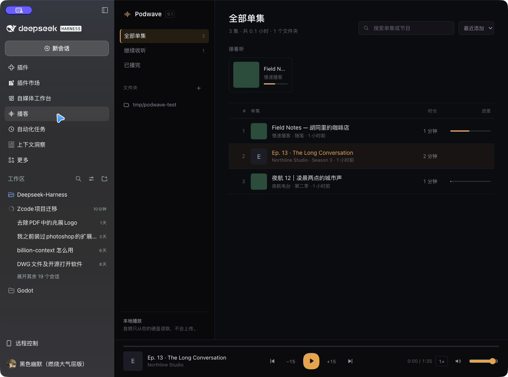

# dsh-podwave

DeepSeek Harness 的本地播客播放器插件。扫描你硬盘上的音频文件夹，在 DSH 侧栏里直接播放，自动记住进度，随时接着听。

不联网、不上传、不依赖订阅源——音频只从本地磁盘读取。



## 安装

需要 DeepSeek Harness `>=0.2.1-rc.5`。

从 [Releases](https://github.com/Watchcats211/dsh-podwave/releases) 下载 `dsh-podwave-0.1.0.tgz`，然后：

```bash
dsh plugin --profile desktop add file:/path/to/dsh-podwave-0.1.0.tgz
```

也可以直接从源码目录装：

```bash
dsh plugin --profile desktop add file:/path/to/dsh-podwave
```

装完重启 DSH（或在已运行的桌面端刷新），侧栏会出现「播客」。

## 用法

- **添加文件夹**：点面板里的 `+`，选择存放播客的目录。会递归扫描 6 层，识别 `mp3 / m4a / m4b / aac / wav / flac / ogg / opus / weba / webm / wma`。
- **播放**：点单集即可；进度每 4 秒自动保存，切集、暂停、关闭时也会立即保存。刷新或重开 DSH 后从上次位置继续。
- **快捷键**：`空格` 播放/暂停，`← / →` 后退/前进 15 秒，`↑ / ↓` 上一个/下一个单集，`/` 聚焦搜索。
- **倍速**：0.75× – 2× 循环；音量与静音在播放条右侧。

数据保存在 `~/.podwave/`：`state.json`（文件夹、进度、设置）和 `covers/`（从音频标签提取的封面）。

## 结构

```
src/host.js       注册 /podwave/api/*：state、episodes、audio（Range）、cover、progress、settings
src/state.js      状态读写（~/.podwave/state.json，原子写）
src/library.js    媒体库扫描（music-metadata 读取标题/艺术家/时长/封面）
client/src/       React 面板（App.jsx、plugin.jsx、styles.css）
build.mjs         PostCSS 作用域前缀 + esbuild 打包为 DSH client bundle
cordis.patch.yml  插件加载声明
```

## 开发

```bash
npm install
npm run build          # 产物 dist/client.js
```

用独立测试 profile 调试（不影响 desktop）：

```bash
dsh podwave-test --from-default-profile web --no-open --port 4790
dsh plugin --profile podwave-test add file:$PWD
```

## 路线图

- [ ] 转写：本地 MLX Qwen3-ASR（中英混合），词级时间戳
- [ ] 说话人分离（sherpa-onnx）
- [ ] 实时字幕与中英对照翻译
- [ ] 导出 SRT / Markdown

## License

MIT
